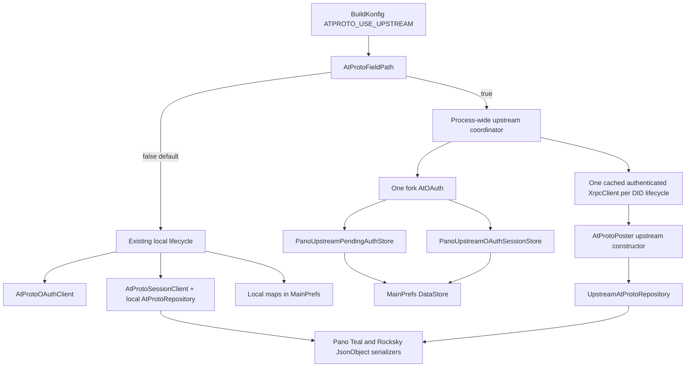

# Reversible upstream ATProto field path

## Checkpoint

Pano can now be compiled into either of two complete AT Protocol lifecycles:

- **local (default):** the existing Pano OAuth, JWK, DPoP, session, repository, and poster path;
- **upstream field path:** the qualified fork's `AtOAuth`, persisted `PendingAuth`/`OAuthSession`, one process-wide authenticated `XrpcClient`, and `UpstreamAtProtoRepository` through the new `AtProtoPoster` constructor.

The selector defaults to local. No local protocol file was removed, no stored key/token format is converted, and no runtime fallback crosses between session types. This is a field-test path, not a production default switch.

## Commits

| Change | Commit | Result |
|---|---|---|
| `yvwxlmyo` | `6f492717` | Persist fork pending/session state beside local state with separate durable adapters. |
| `rmuwvzll` | `16841644` | Own one fork `AtOAuth` and cached authenticated client per process lifecycle. |
| `ttxmmkok` | `eeb20107` | Add public fork-backed `AtProtoPoster(XrpcClient, config)` construction. |
| `rrspwtzn` | `243d6a07` | Add strict default-off build selector and pure compatibility policy. |
| `pksqzzkp` | `2efe2186` | Route login, scope targets, posting, and logout through the selected lifecycle. |

This report is a separate documentation commit.

## Architecture



The UI still calls `LoginViewModel.atProtoStart(handle)` and `atProtoComplete(callbackUrl)`. Android deep-link callbacks and desktop pasted callbacks therefore enter the same methods as before; only the compile-time-selected implementation behind them changes.

## Parallel persistence

Two trailing nullable/default fields were appended to `MainPrefs`:

```kotlin
val atProtoUpstreamPendingAuth: PendingAuth? = null
val atProtoUpstreamSession: OAuthSession? = null
```

Old preference JSON, including `{}`, decodes with both fields absent/null. Existing local fields remain unchanged:

```text
atProtoAuthorizationStates
atProtoSessions
atProtoTargets
atProtoPartialPosts
```

The two fork interfaces cannot share one Kotlin implementation because both define `load()` with different return types. Pano therefore has:

```kotlin
PanoUpstreamPendingAuthStore : PendingAuthStore
PanoUpstreamOAuthSessionStore : OAuthSessionStore
```

Both accept the same `DataStore<MainPrefs>` and use `updateData` for every save/clear. Completion of `updateData` is the persistence boundary required before browser launch and after refresh-token rotation. A test DataStore proves the fields can be saved and cleared independently.

### Deliberate security debt

Pending state includes a PKCE verifier and PKCS8 private key; the session includes refresh/access tokens and DPoP key material. They are still serialized into the existing general MainPrefs file. Encryption at rest and Android backup exclusion remain explicitly deferred, as requested. This field build must not be treated as resolving that exposure.

## One-client lifecycle

`PanoUpstreamAtProtoAccountCoordinator` is a process-wide object. It owns:

- one lazily constructed fork `AtOAuth`;
- one fork pending store and one fork session store;
- Pano's existing bounded [`Requesters.genericKtorClient`](/composeApp/src/commonMain/kotlin/com/arn/scrobble/api/Requesters.kt#L160-L172), including its 40-second request timeout;
- Pano's hosted client metadata URL, redirect URI, and exact Teal/Rocksky create scope;
- one cached authenticated `XrpcClient` for the active DID lifecycle.

Its internal test seam exposes:

```kotlin
suspend fun beginLogin(handleOrDid: String): String
suspend fun completeLogin(callbackUrl: String): OAuthSession
suspend fun currentSession(): OAuthSession?
suspend fun getOrCreateClient(): XrpcClient
suspend fun logout()
suspend fun invalidate()
```

A coroutine `Mutex` serializes callback completion, session reads, client construction, logout, and invalidation. Concurrent callers receive the same client object; `AtOAuth.createClient()` is invoked once. A completed new login or explicit invalidation drops the cached client. Scrobbling asks the coordinator for that same client and may construct a lightweight poster, but never constructs a new DPoP provider.

This is process-wide, not cross-process. Android components running in another process could still instantiate another coordinator and race a rotating refresh token. The deferred atomic cross-process lease/store redesign remains outside this checkpoint.

## Poster and posting behavior

`AtProtoPoster` now has two public construction paths:

```kotlin
// Existing, unchanged local path
AtProtoPoster(httpClient, sessionClient, config)

// Staged fork path
AtProtoPoster(xrpcClient, config)
```

The second constructor creates the internal `UpstreamAtProtoRepository`, preserving Pano's existing local Teal/Rocksky serializers, ordered dual-write, per-target failure capture, and posting-progress behavior. It exposes no generated models. `XrpcClient` remains the only fork transport type at this explicit construction seam.

Tests prove through MockEngine-backed upstream XRPC:

- both Teal and Rocksky writes;
- exact custom `JsonObject` records;
- typed `{uri,cid}` results;
- one failed target does not prevent the other target;
- reduced granted scope selects only Rocksky;
- no provider is constructed by poster/repository code.

## Selector and session incompatibility

The generated field is:

```kotlin
BuildKonfig.ATPROTO_USE_UPSTREAM: Boolean
```

Precedence is command-line Gradle property, then environment variable, then false:

```text
-Patproto.useUpstream=true
ATPROTO_USE_UPSTREAM=true
default: false
```

Values other than exact lowercase `true` or `false` fail Gradle configuration rather than silently selecting a path.

### Exact enable command

The verified upstream compile command is:

```bash
bash gradlew :composeApp:compileKotlinJvm \
  -Patproto.useUpstream=true \
  --rerun-tasks \
  --no-configuration-cache
```

The equivalent environment form is:

```bash
ATPROTO_USE_UPSTREAM=true bash gradlew :composeApp:compileKotlinJvm
```

Omitting both controls compiles the unchanged local default.

### No session conversion or fallback

The formats are intentionally incompatible:

| Local | Fork-backed upstream |
|---|---|
| P-256 private JWK | PKCS8 private bytes + X509 public bytes |
| local `AtProtoToken` with `expiresAt` | fork `OAuthSession` with opaque tokens/scope/nonces |
| DID-keyed local session map | one active fork session field |
| local pending authorization map | one fork `PendingAuth` field |

When the selected path has no session but the other path does, `AtProtoSessionPathMismatchException` instructs the user/tester to remove the AT Protocol account under its original build and perform a fresh login under the selected build. It explicitly says keys are not converted. Both formats may coexist after deliberate field setup; in that case the selector uses only its own format.

The same selected lifecycle drives:

- login start and callback completion;
- granted-scope-to-target derivation;
- posting transport/client;
- logout and client invalidation.

This prevents logging in with one implementation and posting or revoking with the other.

## Verification

### Module tests

- `:atproto:test --rerun-tasks` — **52 tests, 0 failures**.
- New poster tests: 3.
- Existing local repository, OAuth, DPoP, record, and poster tests remain green.

### Focused application tests

The following three classes ran together — **13 tests, 0 failures**:

- `AtProtoFieldPathTest` — both selector values, both mismatch directions, active DID, selected granted scope;
- `PanoUpstreamAtProtoStoresTest` — old JSON, model round-trip, independent durable field updates;
- `PanoUpstreamAtProtoAccountCoordinatorTest` — login, callback/session return, concurrent one-client cache, invalidation, logout.

The full application test suite was not used as a gate because of the known unrelated `MaiTest` trailing-space failure. Its test sources compiled during focused execution; only the named field-path tests ran.

### Compile-time selector checks

Both completed successfully with temporary `local.properties`:

```text
bash gradlew :composeApp:compileKotlinJvm                         # false/default
bash gradlew :composeApp:compileKotlinJvm -Patproto.useUpstream=true
```

The default generated JVM `BuildKonfig` was inspected as `ATPROTO_USE_UPSTREAM = false`. The builds retained existing unrelated Compose/Skiko compatibility and opt-in warnings.

### Dependency boundary

Both `:atproto:runtimeClasspath` and `:composeApp:jvmRuntimeClasspath` resolve only:

```text
io.github.rektide.atproto:oauth:9.11.0-pano.1
io.github.rektide.atproto:runtime:9.11.0-pano.1
io.github.rektide.atproto:runtime-jvm:9.11.0-pano.1
```

There is no `models` or `io.github.kikin81.atproto` artifact.

## Size-basis reconciliation

Two earlier values answer different questions:

### +1.20 MB isolated module graph

[`upstream-migration0.gpt56s.md`](/design/atproto-posting/upstream-migration0.gpt56s.md#size-measurement) compared only `:atproto:runtimeClasspath` before and after adoption:

```text
20 JARs / 7,047,415 bytes
27 JARs / 8,246,081 bytes
delta: 7 JARs / 1,198,666 bytes
```

That baseline had no datetime or content-negotiation artifacts, so it counted their complete JAR sizes, including 753,869 bytes for the datetime compatibility build.

### Approximately +374 KB whole-app incremental graph

[`library-tradeoff0.gpt56s.md`](/design/atproto-posting/library-tradeoff0.gpt56s.md#L41-L51) compared the candidate against Pano's already broad desktop application graph. That graph already carried nearly all Ktor/serialization dependencies and an older datetime coordinate, so the estimate counted fork runtime+OAuth plus only the datetime version replacement: **373,531 bytes**.

Neither number is wrong:

- **1.20 MB** is the isolated `:atproto` configuration's newly resolved external input sum;
- **~374 KB** is the incremental cost after whole-application dependency overlap;
- neither is an APK, DEX, R8, installer, or native-image measurement.

The current `:atproto` project JAR is 334,380 bytes and 152 classes. Against the original 317,209-byte/142-class baseline, the staged adapter plus poster construction path adds 17,171 bytes and 10 classes. Fork dependencies remain external and are not shaded into this JAR.

## Security and operational caveats

1. **Secrets are unencrypted in MainPrefs** and may participate in Android backup. Explicitly deferred, not accepted as final production posture.
2. **The coordinator is per-process only.** No atomic cross-process refresh lease exists.
3. **Strict missing `DPoP-Nonce` remains enabled.** Field builds may reject otherwise useful non-conforming PDS responses; collect privacy-safe exception telemetry without tokens, proofs, nonce values, or bodies.
4. **Maven Local is mutable and machine-local.** Field build reproducibility requires republishing the exact fork or moving immutable artifacts to a private repository.
5. **Fresh login is required across implementations.** Existing local keys/tokens are not migrated.
6. **Only JVM compile/tests ran here.** The fork's API-24-safe date parser is unit tested, but Android API 24/25 device behavior, process death, R8, and backup behavior are not field verified.
7. **No signup path exists** in the coordinator.

## Default-switch and delete gate

Do not make upstream the default or delete local code until all of the following pass:

- immutable/private artifact provenance replaces mutable Maven Local for repeatable builds;
- fresh existing-account login works through Android deep link and desktop paste;
- browser-process death restores fork `PendingAuth` and completes login;
- persisted granted scope enables exactly the granted Teal/Rocksky targets;
- dual write, partial write, retry progress, and duplicate avoidance match local behavior;
- successful response nonce rotation, nonce challenge, invalid-token refresh, terminal `invalid_grant`, logout, and strict missing-nonce telemetry pass against real providers;
- API 24/25 device and current Android tests pass;
- release R8 and desktop packaging/native-image checks pass;
- encryption/backup policy is resolved;
- cross-process refresh ownership is either prevented by deployment architecture or addressed explicitly.

Only after an upstream-default release survives that gate should local OAuth/crypto/repository files be removed in a separate deletion checkpoint. Keeping the selector and local path through initial rollout provides immediate rollback.

## Deferred by instruction

- Android encryption and backup exclusion.
- Atomic cross-process session-store lease/CAS redesign.
- Signup.
- Generated models.
- Fork publication or push beyond existing Maven Local artifacts.
- Local protocol deletion.
- Upstream as the default.

## Code references

- [`MainPrefs.kt` parallel fields](/composeApp/src/commonMain/kotlin/com/arn/scrobble/pref/MainPrefs.kt#L43-L146).
- [`PanoUpstreamAtProtoStores.kt`](/composeApp/src/commonMain/kotlin/com/arn/scrobble/api/atproto/PanoUpstreamAtProtoStores.kt).
- [`PanoUpstreamAtProtoAccountCoordinator.kt`](/composeApp/src/commonMain/kotlin/com/arn/scrobble/api/atproto/PanoUpstreamAtProtoAccountCoordinator.kt).
- [`AtProtoFieldPath.kt`](/composeApp/src/commonMain/kotlin/com/arn/scrobble/api/atproto/AtProtoFieldPath.kt).
- [`LoginViewModel.kt` selected login lifecycle](/composeApp/src/commonMain/kotlin/com/arn/scrobble/onboarding/LoginViewModel.kt#L53-L147).
- [`AtProtoScrobblable.kt` selected posting lifecycle](/composeApp/src/commonMain/kotlin/com/arn/scrobble/api/atproto/AtProtoScrobblable.kt#L28-L81).
- [`Scrobblable.kt` selected logout lifecycle](/composeApp/src/commonMain/kotlin/com/arn/scrobble/api/Scrobblable.kt#L209-L235).
- [`AtProtoPoster.kt` dual constructors](/atproto/src/main/kotlin/com/arn/scrobble/atproto/posting/AtProtoPoster.kt#L56-L86).

## Cross-references

- [`upstream-migration0.gpt56s.md`](/design/atproto-posting/upstream-migration0.gpt56s.md) records local fork publication, dependency filtering, adapter wire behavior, and the isolated graph measurement.
- [`library-tradeoff0.gpt56s.md`](/design/atproto-posting/library-tradeoff0.gpt56s.md) records the original whole-application incremental comparison and why models remain excluded.
- The unpublished fork reports under `/home/rektide/src/atproto-kotlin-boop/design/oauth-conformance/` document OAuth validation, DPoP behavior, strict nonce risk, and Pano-readiness evidence consumed by this field path.
